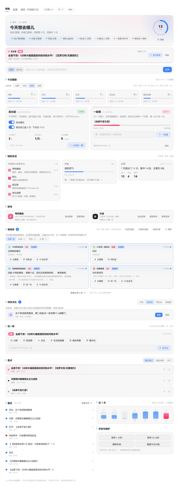
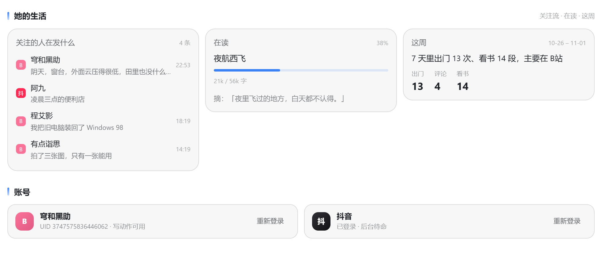
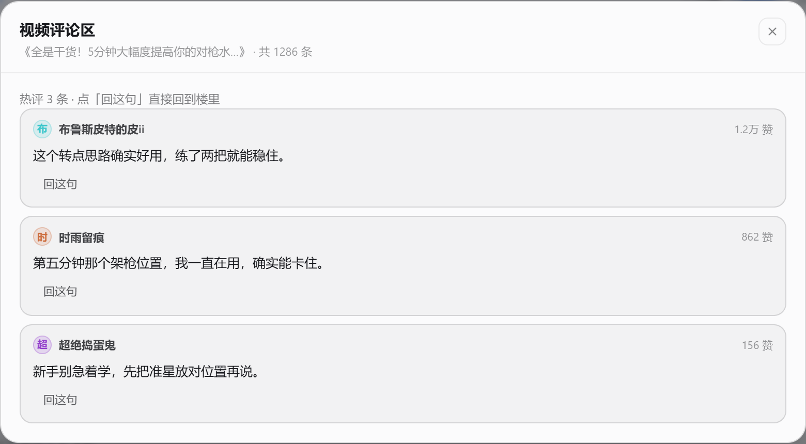
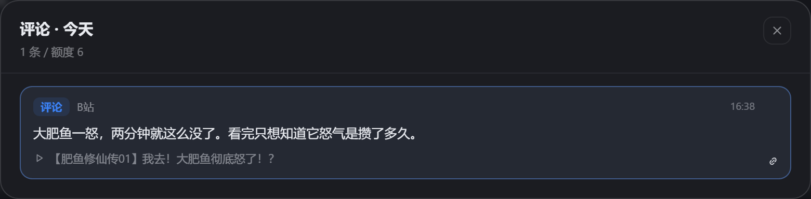

# 摸鱼 · Cortico World


**她在刷视频，你在干别的。** 让 Coopanion 的桌宠自己出门，去 **抖音** 和 **B站** 逛一圈：刷候选、打开你发的视频、点赞、评论、关注、发动态、@ 你、给你发私信。

不是“全自动挂机涨粉”，也不是“无人值守刷量”。它更像一个**有额度、要人点头、会自己喊停**的小家伙：公开动作默认先出草稿，主人在面板点批准才发；所有动作有日/周硬上限；平台一有风控信号就停手。

- 包名：`cortico-world-mosey` / 英文名 Mosey
- 显示名：**摸鱼**
- World id：`stroll`（内部标识，历史原因保留，升级不会丢数据）
- 契约：`cortico` World API 6
- 工具：**3 把**（读、写、改规矩），常驻 schema 约为同类插件的 1/5
- 默认：`enabled=false`，装上不会自己动



面板上面这一屏就是全部操作台：谁在找她、她正在看什么、今天还剩多少额度、待批的草稿、近 7 天的动作分布。**离开这个面板也能用**——所有能力都挂在 3 把工具上，面板只是给主人看的窗口，不是必需品。

配置页按「基础 / 额度与时段 / 互动与身份 / 高级」分成四段，34 个字段全中文，审批方式是下拉选项（全部等我批准 / 点赞自动其余问我 / 只读只写草稿 / 按额度自动）。

---

## 1. 它是什么，不是什么

**它是一层「外出的调度」**——决定什么时候出门、看哪几条、能做什么动作、做完怎么记账。B站的写动作走官方 Web API；抖音的写动作走独立浏览器窗口，打开的就是官网页面，不伪造签名、不绕验证码。

**它不是**：

- 不是又一个平台 SDK。登录态直接用宿主里已有的那份，不重复造轮子
- 不是「全自动挂机涨粉」。公开动作默认出草稿，主人点头才发
- 不是「无人值守刷量」。日/周都有硬上限，一遇风控就停手
- 不是「AI 批量写爆款评论」。只评她真看过的，一条视频只评一次，同一句话不复用

**跟别的互动插件一起用**：一个账号只留一个写手。读可以并存，写会叠加频控——同时开两个，触发验证的概率会明显变高。

**和「刷量工具」的区别，写在设计里**：单账号、单实例、日额度硬上限；公开动作默认要主人点头；不做多开、不做批量养号、不刷播放不刷粉；遇到验证码就停手，不接打码平台、不换 IP、不伪造签名。它的目标是「她自己去逛逛」，不是「把数据刷上去」。

---

## 2. 功能

### 看
- **正在看**：她一开始看东西，面板顶部就出现一条浮条——平台（B站/抖音）、标题、作者、已看多久，还有一个「我也看看」直接在你的浏览器打开；右下角会闪一条提醒。默认不花 token，想要「顺便在对话里说一句」可以在配置里改
- `brief`：一次拿全登录态、今日额度、3 条候选、3 条消息（最省 token 的入口）
- `feed`：B站热门 / 抖音精选，按兴趣词、关注的人、时长、点赞做**本地排序**，不逐条调模型
- `open`：你发什么链接就看什么；默认**后台**（headless）读标题/简介/热评，不弹窗；要一起看才开窗口。B站视频、**动态**（`t.bilibili.com/…`、`/opus/…`）、**专栏**（`/read/cv…`）都认
- `comments`：只读评论区，不把这条记进「最近看过」；视频、动态、专栏都能读，返回作者、原文、赞数和 rpid
- `inbox`：谁回复了你、谁 @ 了你；B站消息按时间排，抖音消息尽力而为
- 面板「谁找你」：**点一条就用你自己的浏览器打开**（评论会直接跳到 `#reply<rpid>`）；能展开全部 15 条、按「私信 / 评论 / @ 我」筛选、标已读、顺手回一句
- **私信收发都通了**：B站的私信会话和消息直接读接口，抖音读 `/chat` 页面；两边的私信都进「谁找你」，标着「1 条未读」。在面板点「回私信」就能回，B站回完还会替你把会话标成已读
- **「B站私信我」**：谁找你右上角一个按钮，点一下她就给你发条 B站私信，用来验证投递链路
- **动态/专栏的评论也能回**：视频、动态、专栏用同一套回复逻辑；面板里点「回一句」直接发到楼里，不用再跳网页
- `search`：B站搜索（WBI 签名）
- `following`：关注的人在发什么。B站走动态流接口（要登录），带作者、标题、发布时间和链接；抖音那边的关注页在后台是空壳，读不到会直言，不拿热门凑数
- `weekly`：最近 7 天的周报，全本地算：出门几次、评论几条、看谁最多、最活跃时段、连续几天。不花 token
- `history`：最近做过什么、草稿、兴趣画像、风控状态



### 读（本地书库）
- 把 `txt` / `md` 放进 `<数据目录>/stroll/books/`，她就能一段一段地读：`books` 看书目、`read` 读一段（默认 900 字）、`note` 存一句摘抄
- 会记进度、接着上次读、读到结尾会说读完了；文件不是 UTF-8 会提示另存，不硬读乱码
- **她只读这一段**：不会假装读过后面，也不复述剧情。想让她聊书，先让她读
- 面板「她的生活 → 在读」显示书名、进度条、已读字数和最近一句摘抄

### 动（全部有额度）
- 点赞 / 取消赞
- 关注 / 取关（默认每天 3 个，需批准）
- 评论 / 回复（默认每天 6 条，需批准；禁止链接、广告、复读）。**动态、专栏下的评论一样能回**：自动读详情拿到真正的评论区 `oid/type`，不再只认 BV 号
- 发动态（B站纯文字，可 @ 主人；默认每天 2 条）
- 私信主人（B站走接口，抖音走页面；**只发主人，也不限量**，不占每日额度）· **收**：评论、@、私信都会进「谁找你」
- 稍后再看（B站，低风险，可自动）
- 面板里的「看这条评论」「TA 的主页」「在浏览器看」「稍后再看」都是一键直达，不占她的后台浏览器
- **评论区弹层**：面板「这一条」旁边点「看评论」，在弹层里翻热评、看原文，点「回这句」当场回到楼里


- **额度条点开就是明细**：点赞、评论、关注、动态、私信、稍后再看六格都能点，弹层里逐条列出「具体是哪个视频 / 评论原文 / 关注了谁 / 发的是什么」，带时间与跳转
- 长列表一律走弹层（谁找你、最近、额度明细），**页面本身不会被撑长**：默认各显示 4–10 条，剩下的在弹层里滚


- @ 主人：评论里按昵称 @，动态里用 at 节点；服务端认不认会在回执里如实说

### 活得多一点
- **活跃度四档**：安静 / 日常 / **活跃（默认）** / 话痨，一键改「赞·评·关注·动态·私信·稍后再看 + 每天出门几次 + 两次之间隔多久」，不用一项项调

  | 档位 | 每天出门 | 间隔 | 赞/评 | 说明 |
  |---|---|---|---|---|
  | 安静 | 1 次 | 5 小时 | 4 / 1 | 只看看，不主动说话 |
  | 日常 | 3 次 | 2.5 小时 | 10 / 4 | 偶尔评一句 |
  | **活跃**（默认） | **5 次** | **90 分钟** | **16 / 6** | 看到真想说的就留一句 |
  | 话痨 | 8 次 | 60 分钟 | 24 / 10 | 评论额度最多 |

- 「两次出门至少隔多久」在配置里也能单独调（30–360 分钟），不必整个换档
- 新号保护默认关掉（老号没必要打折），要留可以在高级里打开；面板上也有「关掉保护」按钮

### 规矩
- 审批矩阵：`confirm`（全批准）/ `auto_low_risk`（赞自动）/ `auto_all`（按额度）/ `dry_run`（只读）
- 日额度 + 周额度 + 新号保护（前 3 天 50%、4–7 天 80%，默认关闭，老号不用打折）
- 安静时段（默认 23:00-08:00，只读不写）
- 动作冷却（默认 90 秒）、同对象 24 小时去重、同视频 7 天不重复评论
- 平台风控信号自动停手 12-72 小时；连续两次升级
- 一键手刹（1 小时 / 今天 / 自定义）
- 面板批准箱：批准才执行；**模型不能自己批准**

### 自己出门
- 默认每天 **5 次**，09:00-23:00 之间随机，间隔至少 90 分钟，安静时段/风控/额度用完自动跳过
- 你手动让她看东西**不会**推迟下一次自动出门（两条计时各自独立）
- 出门只推一条 `stroll.due`，让模型决定去不去；不想去可以什么都不做
- 每天模型预算（默认 9000）会折算成最多出门次数，避免“越逛越贵”

---

## 3. 安装（Windows / Coopanion）

> 先关掉 Coopanion，装完再开。以下路径按你机器上的 `F:\Coopanion` 写，换了盘符就替换。

### 3.1 复制插件

把本目录复制到：

```
F:\Coopanion\data\local-extensions\cortico-world-mosey
```

### 3.2 挂到扩展工作区

编辑 `F:\Coopanion\data\extensions\package.json`，在 `dependencies` 里加一行：

```json
"cortico-world-mosey": "link:F:/Coopanion/data/local-extensions/cortico-world-mosey"
```

然后在 `F:\Coopanion\data\extensions` 里执行：

```bat
cd /d F:\Coopanion\data\extensions
corepack pnpm install
```

> 如果 `corepack` 不在 PATH，用应用自带的 Node：`F:\Coopanion\Coopanion.exe` 同级的 `resources` 里有运行时；也可以直接用系统 Node 22 的 `npx pnpm install`。

### 3.3 给插件自己装一次依赖（抖音浏览器要用）

```bat
cd /d F:\Coopanion\data\local-extensions\cortico-world-mosey
corepack pnpm install
```

> 不装也能跑 B站；抖音会提示找不到 `playwright-core`。插件会尝试从 Coopanion 的扩展目录里找一份，但自己装最稳。

### 3.4 启动并接入

1. 打开 Coopanion → 左侧 **World 扩展** → 找到 **摸鱼**（图标是两只脚印）。
2. 点右侧电源键 → **接入**。
3. 点插件卡片打开面板。

### 3.5 第一次配置

面板从上到下：

1. **登录 B站**：如果应用里已有 B站登录（比如 `穹和黑助`），会自动复用；没有就点「登录 B站」，在弹出的窗口里扫码，登上后会自动收回登录态并关窗。要换号先点「退出登录」。
2. **登录抖音**：点「登录 / 验证」，在弹出窗口扫码；登录态保存在 `data/stroll/douyin-profile`，以后不用重复扫。换号同样先点「退出登录」。
3. **设主人**：设置里填 `主人 B站 UID`（用于 @ 和 B站私信）。填了 UID 后程序会自己查昵称，查不到才用 `主人 B站昵称`。
   - 想让她发抖音私信，再填 `主人抖音`：**最稳的是主页分享链接**（抖音 App →「我」→ 分享 → 复制链接，整段粘进来），也可以直接填 `MS4w` 开头的 sec_uid。抖音号也能填、面板上会出「绑定这个号」，但抖音的搜索页对自动化浏览器基本是空的（反爬），解析成功率不高，所以别把这条路当唯一。
   - **抖音私信有个硬限制**：抖音不允许给自己发私信。所以桌宠登录的抖音号必须和你自己的号是两个号；如果只有一个号，抖音这条路走不通（B站私信不受影响）。面板上的「查登录号」会告诉她现在用的是哪个号、和你绑的是不是同一个。
4. **审批方式**：建议先用 `全部等我批准`。确认行为稳定后，再考虑 `点赞自动，其余等我批准`。
5. **兴趣词**：填你真正爱看的，比如 `无畏契约, 独立游戏, 做饭`。只影响本地排序，不花 token。

---

## 4. 怎么用

直接在对话里说：

- 「去逛逛，看到有意思的跟我说」
- 「看看这个视频：https://www.bilibili.com/video/BV... 说下你的看法」
- 「这条抖音你去点个赞」→ 出草稿 → 面板点批准
- 「在这条下面留句话，别太官方」→ 出草稿 → 批准
- 「发条动态，就说今天下雨了」→ 出草稿 → 批准
- 「今天别社交」→ 拉手刹
- 「这周别关注人」→ 关掉关注
- 「你最近都看了什么」→ `history`

面板里可以：

- 看今日额度 / 风控 / 登录态
- 批准或拒绝草稿
- 贴链接让她打开
- 暂停 1 小时 / 今天 / 解除
- 打开两个平台的登录窗

---

## 5. Token 账

| 项目 | 大约 |
|---|---|
| 3 把工具的 schema（每轮常驻） | ~700-900 token |
| `brief`（状态 + 3 候选 + 3 消息） | ~600-800 |
| `feed` 6 条 | ~450-600 |
| `open` B站（文字 + 5 热评） | ~500-700 |
| `open` 抖音（文字 + 5 评论） | ~500-700 |
| 每抽 1 帧 | ~450-550 |
| 一次动作草稿 | ~120-200 |

默认一天：5 次自动出门（~800/次）+ 你找她 1-2 次（~600/次）+ 几条评论草稿（~150/条）≈ **5k**，在默认 9000 预算以内。

省 token 的硬规则（写在环境提示词里）：

- 先 `brief`，不要 `status`→`feed`→`inbox` 连刷
- 一次只开 0-2 条
- 默认不抽帧；要画面才 `frames:1`
- 看过的视频 7 天内不重复看
- 不在每条候选上单独问模型

---

## 6. “稳定不封号”这件事，说清楚

**没有任何插件能保证不封号。** 平台的风控、审核、限流是黑箱，自动化互动本身也可能违反平台规则。摸鱼能做的是把风险压到很低，而不是消灭：

- **用小号**：默认复用应用里的 B站登录（通常就是桌宠号）；不要把大号绑进来。抖音也建议单独号。
- **一号一个写手**：同一个账号只让一个插件负责写（点赞 / 评论 / 关注）。读可以并存，写会叠加频控；同时开两个，触发验证的概率明显变高。
- **量很小**：默认每天 16 赞、6 评、3 关、2 动态；周上限更紧（赞 120 / 评 40）。**私信不限额**（只发给主人，按聊天算，只防连点）嫌多就在面板点回「日常」或「安静」。
- **像人**：随机停顿、单线程、先看后动、不批量、不秒回、不复制粘贴同一句。
- **不绕验证**：遇到验证码/滑块/“操作频繁”就停，不接打码、不换 IP、不伪造签名。
- **不碰敏感内容**：政治、医疗、投资建议、隐私、未成年人、骂战，一律不评。
- **会自己停**：412/429、`-352/-412/-509`、页面验证、登录失效 → 停写并通知你；连续两次升级冷却。
- **写结果不明不重发**：超时/断线时返回 `WRITE_UNCERTAIN`，先去平台确认，别自动重试。

如果你很在意账号：把审批设成 `只读（全部草稿）`，只让她看和写草稿，永远手动发。

---

## 7. 工具速查

### `stroll`（只读）

```json
{"action":"brief"}
{"action":"open","url":"https://www.douyin.com/video/769..."}
{"action":"open","url":"https://www.bilibili.com/video/BV...","frames":1}
{"action":"open","url":"https://t.bilibili.com/1260000000000000000"}
{"action":"comments","url":"https://www.bilibili.com/opus/1260000000000000000","n":10}
{"action":"feed","platform":"douyin","n":4}
{"action":"inbox","n":5}
{"action":"following","platform":"bilibili","n":6}
{"action":"weekly","days":7}
{"action":"books"}
{"action":"read","book":"夜航西飞","chars":900}
{"action":"search","query":"独立游戏"}
{"action":"note","text":"夜里飞过的地方，白天都不认得。"}
{"action":"history"}
```

### `stroll_act`（写）

```json
{"action":"like","platform":"bilibili","target":"BV1..."}
{"action":"comment","platform":"douyin","target":"https://www.douyin.com/video/769...","text":"这个转场有点东西"}
{"action":"comment","platform":"bilibili","target":"https://t.bilibili.com/1260000000000000000","text":"这张的光线压得很低"}
{"action":"reply","platform":"bilibili","target":"https://t.bilibili.com/1260000000000000000","reply_to":"322000000000","text":"在等。"}
{"action":"post","text":"今天下雨，适合在家打游戏。","mention_owner":true}
{"action":"dm","platform":"bilibili","target":"主人的UID","text":"看到个视频，你肯定喜欢"}
{"action":"approve","draft_id":"..."}   // 会被拒绝：批准只能主人在面板点
```

### `stroll_policy`

```json
{"action":"get"}
{"action":"set","patch":{"dailyComments":2,"approval":"confirm","ownerUid":"123456"}}
{"action":"pause","hours":24}
{"action":"resume"}
```

---

## 8. 目录

```
src/
  index.js        默认导出
  definition.js   WorldDefinition（id / defaults / create / describe）
  world.js        生命周期、工具路由、草稿批准、面板 API、自动出门
  config.js       配置默认值与配置页 schema
  policy.js       额度、安静时段、冷却、去重、风控停手
  store.js        状态、草稿、动作日志、兴趣、设备 ID
  bilibili.js     B站 Web API（WBI 签名、评论、点赞、关注、动态、私信、消息）
  douyin.js       抖音浏览器适配器（读 feed/视频/评论；点赞/关注/评论/私信）
  tools.js        3 把工具与事件声明
  ENV_PROMPT.md   环境提示词
webui/
  client.js       面板：状态、批准、打开链接、手刹、登录
  style.css
assets/icon.png
describe.json
```

数据都在 `F:\Coopanion\data\home\companion\data\stroll\`：

- `state.json`：额度、草稿、动作、风控、兴趣
- `douyin-profile\`：抖音独立浏览器资料
- `bilibili.json`：如果从摸鱼窗口登录 B站，cookie 存这里（权限 600）

---

## 9. 常见问题

**列表里没有「摸鱼」**
- `extensions/package.json` 的 link 没加，或 `pnpm install` 没跑；装完必须重启进程（ESM 不热换代码）。
- 看 `F:\Coopanion\data\extensions\node_modules\cortico-world-mosey` 是否存在（应该是快捷链接）。

**B站显示未登录**
- 面板点「登录 B站」→ 扫码 → 「刷新 B站登录态」。
- 或把 `sharedBiliCookie` 打开，复用应用已有的 `data/credentials.json`。

**抖音窗口打不开**
- 需要 Edge 或 Chrome；`playwright-core` 没装上时在 `extensions` 里重跑 `corepack pnpm install`。
- 第一次启动会弹窗，登录后资料保存在 `douyin-profile`。

**评论发了但别人看不见**
- 可能审核中，也可能被限流。回执会写「公开列表暂未看到」，不要连续重发；隔 24 小时再看。

**提示“结果不明”**
- 不要去重试。先去平台看有没有发出去；确认没有再处理。重复发比漏发更伤号。

**Token 还是高**
- `autoSessionsPerDay=0`、`framesPerOpen=0`、`approval=dry_run`；让她只在你叫的时候动。

---

## 10. 卸载

1. 从 `extensions/package.json` 删掉 `cortico-world-mosey` 一行。
2. `cd /d F:\Coopanion\data\extensions && corepack pnpm install`
3. 删除 `local-extensions\cortico-world-mosey`。
4. 想清干净就删 `data\home\companion\data\stroll\`（会丢额度记录、草稿和抖音登录资料）。

---

## 11. 许可

MIT。开发过程中参考了 Coopanion 生态中若干以 MIT 许可发布的插件（接口路径、签名方式、页面结构识别），具体致谢见 `NOTICE.md`。
